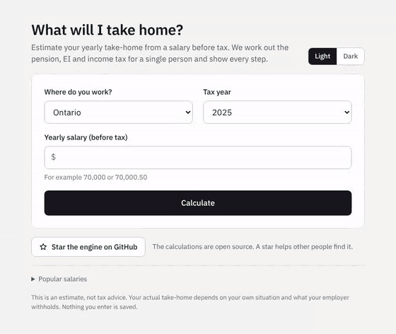

# After Tax Lens

**Enter a yearly salary and see what you would take home, with every step of the working shown.**

It is for anyone in Canada who wants to understand their pay and not only see a total. It covers Ontario and Alberta for 2025 and 2026 (2026 uses provisional figures), for a single person on a salary.

**Try it: [aftertaxlens.com](https://aftertaxlens.com)**

For example, $70,000 in Ontario for 2025 comes to CA$53,468.68 after the Canada Pension Plan, Employment Insurance and income tax.

## What makes it different

- Follows the published forms. Each figure is a line from a tax form, so you can check any number against the form it came from.
- It shows the working. Open "Show how this was worked out" for the breakdown, or the advanced view for every line.
- It is an estimate, not tax advice. Your own situation and what your employer withholds may differ.
- Nothing you enter is saved.

The figures come from the open source [tax-engine](https://github.com/The-Pied-Piper/tax-engine), served by [tax-service](https://github.com/The-Pied-Piper/tax-service). This repository is the website.

## Contributing

Found a mistake or want to help? Read [CONTRIBUTING.md](CONTRIBUTING.md) and look at the [open issues](https://github.com/The-Pied-Piper/tax-frontend/issues). To run the site on your own computer, see [DEVELOPMENT.md](DEVELOPMENT.md).

## License

Apache 2.0, see [LICENSE](LICENSE).
